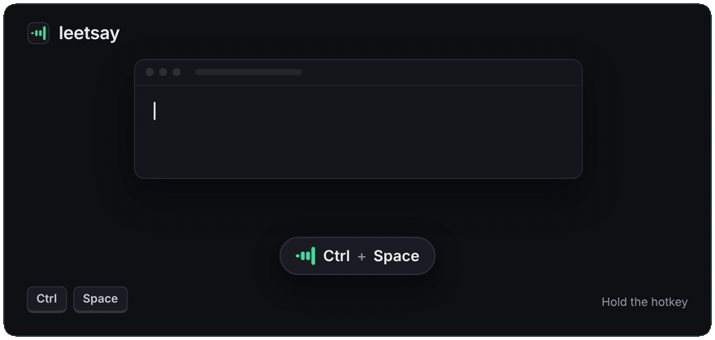

  

Illustration of typing as you speak (an optional setting), shown with the Windows hotkey; on a Mac it is Right Option. The real card follows your accent colour and theme.

Local dictation for the Mac. Hold a key, speak, let go: your words are typed
into whatever app you are using.

- Talk your prompts into an AI coding tool, or dictate emails, chats and documents.
- Speech is recognised on your own Mac. No accounts, statistics or tracking.
- Open source, provided as is: please read the [Disclaimer](#disclaimer).

**[Download for Mac](https://github.com/sudo-csmith/leetsay-mac/releases)** (macOS 14 Sonoma or later, Intel or Apple Silicon, a microphone, about 1 GB of free memory and 700 MB of disk space). The Windows version is at [sudo-csmith/leetsay](https://github.com/sudo-csmith/leetsay).

## How it works

- **The microphone** is on only while you hold the hotkey (Right Option at
  first), or, in press mode, between two presses of it or two clicks on the
  small pill.
- **Speech becomes text on your Mac**, using NVIDIA's Parakeet speech model.
  leetsay is designed not to save your audio or send it anywhere.
- **The model is downloaded once** (about 660 MB) from this project's
  [leetsay-models](https://github.com/sudo-csmith/leetsay-models) page on
  github.com, after you agree in a window that says "This application will go
  online". Every file is checked against a fingerprint built into leetsay.
- **leetsay blocks its own network access** and opens it only for a download
  or update check you have just agreed to, only to GitHub's servers. Settings ›
  Privacy shows the block. leetsay tests it each time it starts offline (that
  is, unless a download you agreed to in Settings is about to run) and writes
  `network block check: passed` in its log; Activity Monitor › Network shows
  leetsay at zero bytes otherwise.
- **This covers leetsay, not the apps you type into.** A chat or web page may
  send your text online; leetsay cannot see or control that.

More in [PRIVACY.md](PRIVACY.md).

## Installing

1. Download the `.dmg` for your kind of Mac from the newest
   [release](https://github.com/sudo-csmith/leetsay-mac/releases): Apple menu ›
   About This Mac shows "Intel", or "Apple M1", "M2" and so on.
2. Open it and drag **leetsay** into **Applications**, then open it from there.
   macOS asks once whether to open an app from the internet: click **Open**.
3. After a short **Before you start** note (hold the button to confirm) and
   the model download, **Set up leetsay** has three short steps and one
   optional: **Let leetsay type for you** (click **Open Accessibility
   settings** and switch leetsay on; macOS calls this "Accessibility"), **Let
   leetsay hear you** (click **Allow the microphone**, then **Allow**), **Try
   it**, and **Make it yours (optional)**: a colour, and **Start at login**
   (ticked; untick it if you'd rather open leetsay yourself).

leetsay is signed and notarised by Apple (see [Code signing](#code-signing)).
Coming from a 0.0.x test version? Those were unsigned, so macOS asks for the
permissions once more; if the typing step doesn't tick, select the old leetsay
in System Settings › Privacy & Security › Accessibility, click **–**, and add
it again with **+**.

**Checking the download (optional).** Each release lists a SHA-256
fingerprint. In Terminal, type `shasum -a 256 ` (with a space), drag the
`.dmg` onto the window, press Return and compare. If it differs, don't open it.

**With Python instead:** install [Python 3.13](https://www.python.org/downloads/)
(python.org is a third-party website that we do not run or control), download
this repository, and in its folder run `python3.13 -m venv .venv`,
`.venv/bin/pip install -r requirements-mac.txt` and
`.venv/bin/python -I leetsay_mac.py`. macOS then gives the permissions to
Terminal, not to leetsay.

## Using it

- **Hold Right Option, speak, let go.** The text is typed where your cursor
  is. Right Command, Control or Shift work too, and **Press to start and
  stop** instead of holding (Settings › General). With another key (⌥E for é)
  it works as usual and nothing is recorded.
- **Settings:** right-click the small pill, or click the leetsay icon in the
  menu bar. **Quit** is in that menu.
- **The dot on the pill** is a status light: your colour when ready, amber
  while loading or during setup, red when something needs you.
- **No text box selected:** on a web page or in a list, leetsay types nothing,
  because letters would work as shortcuts there (Settings › Typing).
- **Type as you speak** (Settings › Typing, off by default) types your words
  while you talk. It is a little less accurate, because each word is typed
  before the rest of the sentence is heard.
- **Languages:** English by default; a model for 25 European languages is in
  Settings › Model.
- **Word replacements** fix names the model doesn't know. Filler words such as
  "um" are left out by default. Settings move between Macs and PCs with
  **Export settings** and **Import settings** (Settings › Privacy).

## Uninstalling

In Settings › Model, **Remove model**; untick **Start at login** (Settings ›
General); quit leetsay and drag it from Applications to the Bin. To remove its
settings and log too, delete `~/Library/Application Support/leetsay` and
`~/Library/Logs/leetsay` (Finder › Go › Go to Folder…), and remove leetsay
from System Settings › Privacy & Security › Accessibility and Microphone.

## Disclaimer

- **No warranty.** leetsay is provided "as is", without warranty of any kind.
  The author is not liable for any claim or damages arising from it or its
  use. Full terms: [LICENSE](LICENSE). You use it at your own risk.
- **The text comes from a speech model made by others** and can contain
  mistakes, missing words or words never said. Always check it before you
  send it, especially if leetsay presses Return for you. Do not rely on it
  where a wrong word could cause harm or loss (medical, legal, financial,
  safety or emergency use). It is not an assistive or medical device.
- **Where the text goes is up to you.** leetsay types into whichever app has
  the focus and cannot control what that app does with the text. Text box
  detection is a help, not a guarantee. Do not dictate passwords or sensitive
  information. People nearby can hear you and anyone who sees your screen can
  read the pop-up.
- **Features that act for you** (all off by default): pressing a key after
  typing can send a message before you read it; type as you speak doesn't
  correct words already typed; clipboard paste leaves the text on the
  clipboard for about a second; missed text safety keeps your last dictation
  in memory for 5 minutes.
- **Your responsibility.** You are responsible for how you use leetsay,
  including laws on recording speech, consent from others who may be
  recorded, and your employer's or school's rules.
- **Third parties.** Speech models, libraries and websites used by leetsay
  belong to others and have their own licences and terms
  ([CREDITS.md](CREDITS.md)). Linked websites are third-party websites that we
  do not run or control.
- **No affiliation.** leetsay is independent and not affiliated with,
  endorsed or sponsored by Apple, NVIDIA, GitHub, Microsoft, the Qt Company,
  the Silero Team or the Python Software Foundation. Apple, Mac and macOS are trademarks
  of Apple Inc.; other names belong to their owners and are used only to
  describe what leetsay works with.
- **Official downloads** are only those on this repository's
  [Releases](https://github.com/sudo-csmith/leetsay-mac/releases) page.
- **Name and icon.** The MIT licence covers the code, not the name "leetsay"
  or its icon. Modified copies must use a different name and must not appear
  official.
- **No support obligation.** Help and updates are offered when possible, with
  no promise; any version or download may be withdrawn.
- **Limits.** Nothing here limits liability that cannot be limited by law. If
  any part cannot be enforced, the rest still applies. The licences are also
  inside the app (leetsay.app › Contents › Resources › licenses).

## Code signing

Releases from 0.2.3 are signed with an Apple Developer ID, under the
developer's identity as verified by Apple, and notarised by Apple (its
automatic malware check), so macOS confirms who made leetsay and that it
hasn't been changed. Every release is built from this repository and
approved by hand.

## Licence and credits

MIT licence, see [LICENSE](LICENSE). Speech model: Parakeet TDT 0.6B v2 by
NVIDIA Corporation, under the CC-BY-4.0 licence, converted to ONNX and reduced
to 8 bits by this project
([github.com/sudo-csmith/leetsay-models](https://github.com/sudo-csmith/leetsay-models)).
Not reviewed or endorsed by NVIDIA. The 25-language Parakeet TDT 0.6B v3 is
credited the same way; these and the libraries leetsay uses are listed in
[CREDITS.md](CREDITS.md).
Security problems: [SECURITY.md](SECURITY.md).
